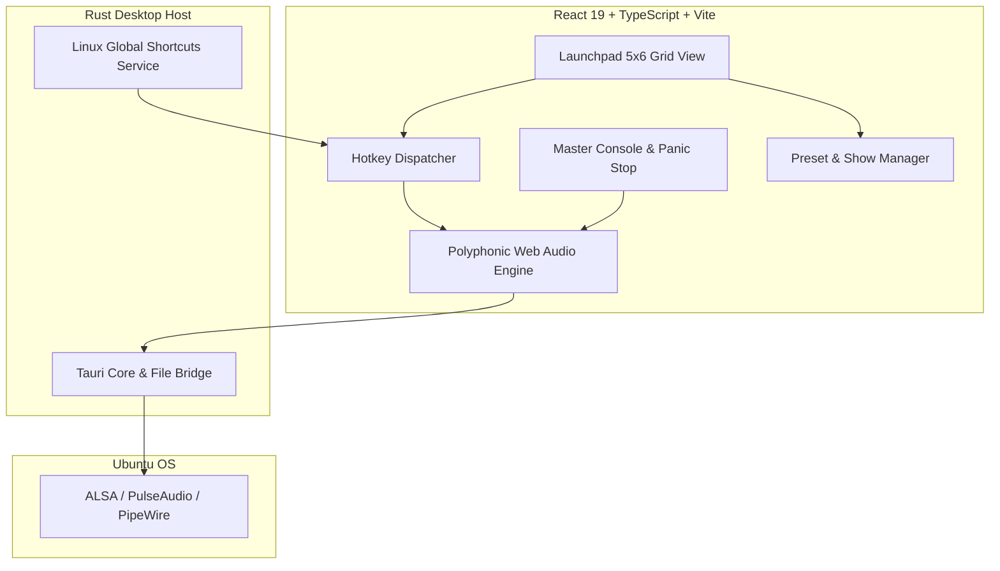

# PLAYMUSIC STUDIO - SYSTEM ARCHITECTURE DOCUMENT

## 1. Executive Summary
**PlayMusic Studio** is an ultra-low latency, multi-track audio workstation designed for live event management, theater stages, conferences, and soundboard technicians on Ubuntu 24.04 / 26.04 (Linux Desktop).
Unlike traditional media players that restrict playback to a single file with clumsy queue switching, PlayMusic Studio provides **30 simultaneous deck slots** organized in a 5x6 Launchpad Grid, each with dedicated hotkeys, individual Mute toggles, volume faders, numerical cue-in points, looping options, and polyphonic audio routing.

## 2. Finalized Feature Specification (Post Grill-Me Alignment)
1. **Capacity & Grid**: 30 simultaneous slots in a 5x6 Launchpad layout.
2. **Polyphonic Independent Playback**: Each slot plays independently; multiple tracks (e.g. ambient background + applause stinger) can play simultaneously.
3. **Dedicated Slot Controls**:
   - **Play / Pause / Stop**: Instant cue trigger.
   - **Individual Mute Button**: Mutes audio immediately without pausing playback timeline.
   - **Loop / One-Shot Toggle**: Switch between repeating indefinitely (background ambience) or stopping at track end.
   - **Numerical Cue In (Start Offset)**: Specify exact start time (e.g. `00:04.5`) to skip silent intros and jump straight to the climax.
   - **Custom Label & 8 Stage Colors**: Quick visual recognition in dark backstage sound booths (e.g. MC In, Award Fanfare, Claps, Warning).
   - **Volume Fader**: Independent gain control (0% to 100%) per slot.
   - **Live Time Remaining & Elapsed**: Countdown timer on every active deck.
4. **Master Console**:
   - **Master Volume**: Global fader for the entire system.
   - **Master Panic Stop / Mute All (`Spacebar` / `Esc`)**: Emergency stop button for instant silence during speeches.
   - **Fade-Out Duration Slider**: Configurable smooth fade-out (0.5s - 5.0s) for non-jarring track stops.
   - **Active Tracks Counter**: Real-time counter of playing slots (e.g. `2/30 Playing`).
5. **Session & Preset Management**:
   - Save / Load `.json` event preset profiles (audio paths, volume, labels, colors, hotkeys, cue offsets).
   - Drag & drop audio files directly from Ubuntu Files into any slot.
6. **Zero-Latency Audio Engine**:
   - Preloaded `AudioBuffer` in RAM with <5ms trigger latency.
   - Universal format support: `.mp3`, `.wav`, `.ogg`, `.flac`, `.m4a`.

## 3. Architectural Blueprint



## 4. Module Directory Layout
```
playmusic/
├── frontend/               # React 19 Client UI & Audio Engine
│   ├── src/
│   │   ├── components/     # UI widgets (DeckCard, MasterConsole, KeymapModal)
│   │   ├── features/       # audio, hotkeys, preset state & logic
│   │   ├── types/          # TypeScript interfaces & Zod schemas
│   │   └── utils/          # Structured logger, JSend response envelope
├── src-tauri/              # Rust Tauri Desktop Bridge (Ubuntu/Linux)
├── docs/                   # Architecture & Progress documentation
└── .local/                 # Git-ignored developer scratchpad & local notes
```
